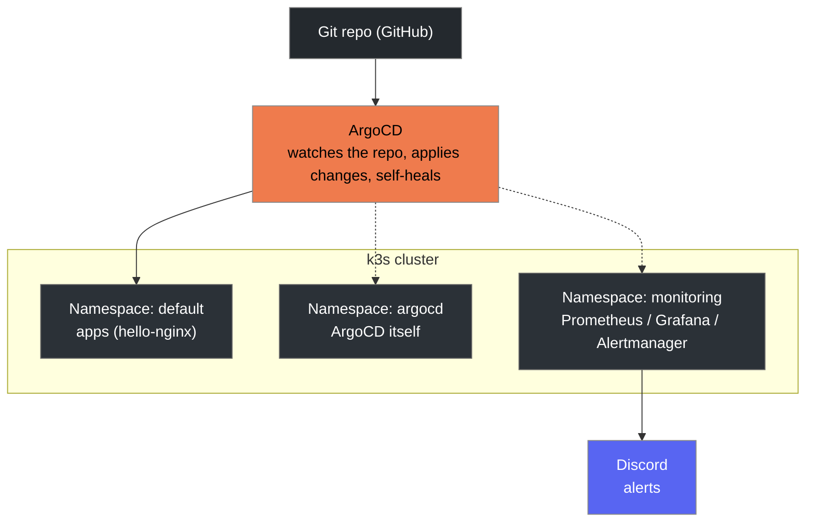
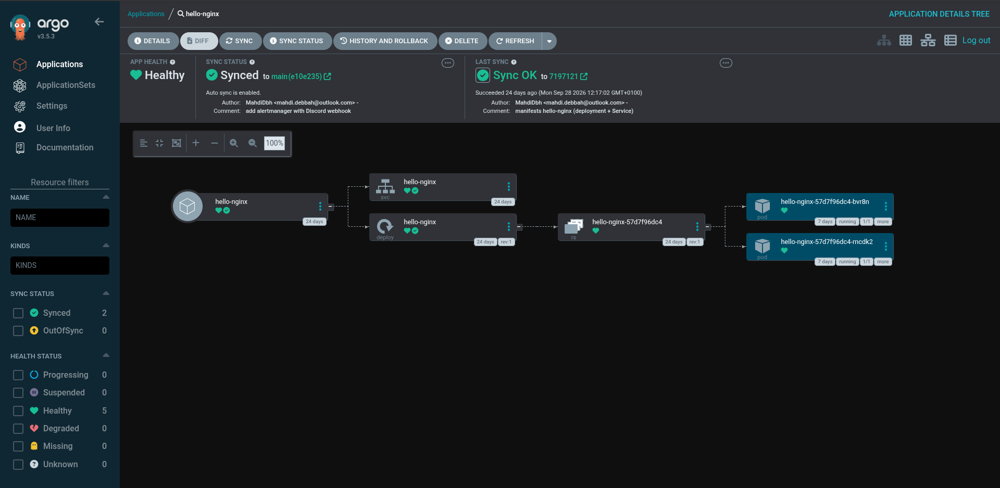
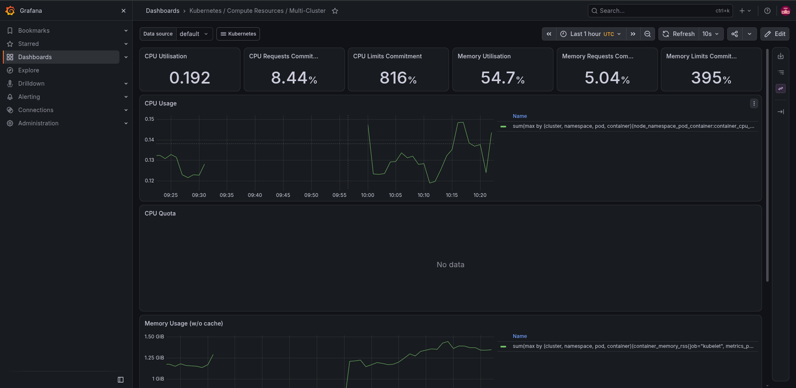
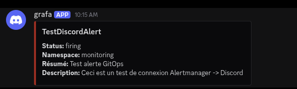

# GitOps Kubernetes Cluster

A Kubernetes cluster (k3s) fully driven by Git via **ArgoCD** (GitOps),
with a complete observability stack (**Prometheus/Grafana**), an alerting
pipeline (**Alertmanager → Discord**), and a validated resilience test
(basic chaos engineering).

## Goal

Demonstrate a complete, end-to-end GitOps pipeline on a real Kubernetes
cluster:

- Application deployment driven only by Git (no manual `kubectl apply`
  for the demo app)
- Automatic sync + self-healing (ArgoCD reverts any manual change that
  drifts from Git)
- Full observability (metrics, dashboards)
- Proactive alerting to Discord
- Native Kubernetes resilience validated with a measured chaos test

## Architecture



## Tech stack

| Component | Role |
|---|---|
| [k3s](https://k3s.io/) | Lightweight Kubernetes distribution |
| kubectl | Cluster control CLI |
| [ArgoCD](https://argo-cd.readthedocs.io/) | GitOps controller (syncs Git → cluster) |
| [Helm](https://helm.sh/) | Kubernetes package manager |
| [kube-prometheus-stack](https://github.com/prometheus-community/helm-charts) | Prometheus + Grafana + Alertmanager |
| Discord Webhook | Alert delivery |

## Repository structure

```
gitops-k8s-cluster/
├── README.md
├── docs/
│   └── setup.md                # k3s/kubectl/helm install, alerting setup
├── bootstrap/
│   └── install-argocd.sh        # ArgoCD bootstrap
├── apps/
│   └── hello-nginx/
│       ├── deployment.yaml
│       └── service.yaml
├── argocd-apps/
│   └── hello-nginx-app.yaml     # ArgoCD Application (GitOps entrypoint)
├── monitoring/
│   ├── install.sh
│   ├── values.yaml
│   └── alertmanager-config.yaml # Alertmanager -> Discord routing
├── chaos/
│   └── kill-random-pod.sh       # resilience / self-healing test
└── assets/
    └── (screenshots)
```

## Getting started

Detailed instructions in [`docs/setup.md`](docs/setup.md). Summary:

```bash
# 1. Install k3s, kubectl, Helm
curl -sfL https://get.k3s.io | sh -
sudo systemctl enable --now k3s
mkdir -p ~/.kube && sudo cp /etc/rancher/k3s/k3s.yaml ~/.kube/config
sudo chown $(id -u):$(id -g) ~/.kube/config
export KUBECONFIG=~/.kube/config
curl -fsSL https://raw.githubusercontent.com/helm/helm/main/scripts/get-helm-3 | bash

# 2. Bootstrap ArgoCD
./bootstrap/install-argocd.sh

# 3. Deploy the demo app via GitOps
kubectl apply -f argocd-apps/hello-nginx-app.yaml
# ArgoCD clones the repo and automatically deploys apps/hello-nginx/

# 4. Install the monitoring stack
./monitoring/install.sh

# 5. Set up Discord alerting (see docs/setup.md for details)
kubectl create secret generic alertmanager-discord-webhook \
  --namespace monitoring \
  --from-literal=webhookURL='<DISCORD_WEBHOOK_URL>'
kubectl apply -f monitoring/alertmanager-config.yaml
```

## Accessing the dashboards

| Service | Command | URL |
|---|---|---|
| ArgoCD | `kubectl port-forward svc/argocd-server -n argocd 8443:443` | https://localhost:8443 |
| Grafana | `kubectl port-forward svc/kube-prometheus-stack-grafana -n monitoring 3000:80` | http://localhost:3000 |
| hello-nginx | `kubectl port-forward svc/hello-nginx -n default 8888:80` | http://localhost:8888 |

## Pipeline validation

### ArgoCD self-healing (Git as the source of truth)

A manual change that drifts from Git is automatically reverted:

```bash
kubectl scale deployment hello-nginx -n default --replicas=0
# ArgoCD detects the drift and restores replicas=2 within seconds
```



### Observability

Grafana dashboards (cluster, node, and pod metrics) fed by Prometheus:



### Alerting

Alertmanager routes alerts from the `monitoring` namespace to a Discord
webhook (native `discord_configs` receiver), validated with a real test
alert:



### Resilience test (chaos engineering)

Script [`chaos/kill-random-pod.sh`](chaos/kill-random-pod.sh): deletes a
random `hello-nginx` pod and measures the time Kubernetes takes to
recreate it.

```bash
./chaos/kill-random-pod.sh
```

**Observed result**: deleted pod → new pod `Running`/`Ready` in
**8 seconds**, with no service interruption (the other replica kept
serving traffic throughout the replacement).

## Known limitations

- Prometheus retention is limited to 3 days with `emptyDir` storage
  (non-persistent) — sized for a single-node lab cluster; revisit with a
  `storageClass` + PVC in production.
- `AlertmanagerConfig` defaults to being scoped to the `monitoring`
  namespace (prometheus-operator behavior): alerts from `default` or
  `argocd` are not yet routed to Discord.
- The Discord webhook is stored only in a manually-created Kubernetes
  Secret — never in Git (see [`docs/setup.md`](docs/setup.md)).
